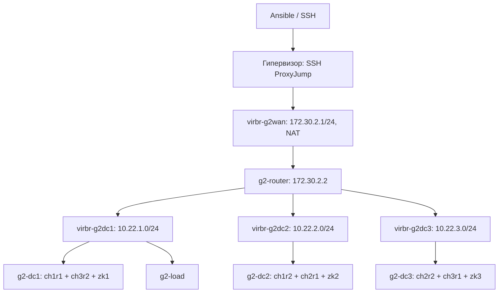

# Топология и адреса

Новая конфигурация подготовлена в коде; на действующий сервер ещё не применена.

| ВМ | IP | RAM, МиБ | vCPU | Диски данных |
|---|---|---:|---:|---|
| g2-router | 172.30.2.2 | 512 | 1 | — |
| g2-dc1 | 10.22.1.10 | 4096 | 2 | 8 × 5 ГиБ |
| g2-dc2 | 10.22.2.10 | 4096 | 2 | 8 × 5 ГиБ |
| g2-dc3 | 10.22.3.10 | 4096 | 2 | 8 × 5 ГиБ |
| g2-load | 10.22.1.30 | 512 | 1 | — |

Итого 13 ГиБ. На совмещённых ВМ 4 ГиБ делят ОС, два ClickHouse и ZooKeeper.
У каждой ВМ корневой диск `vda` размером 8 ГиБ. Диски данных не форматируются.

## Контракт для ролей сервисов

Три узла входят одновременно в группы `clickhouse` и `zookeeper`.
У каждого заданы `zookeeper_id` и список `clickhouse_instances`.
Роли сервисов должны обходить этот список: прежние скалярные `shard`/`replica`
на уровне хоста больше не описывают совмещённый узел.

| ВМ | Экземпляр | Шард / реплика | TCP / HTTP / interserver | Диски | RAID |
|---|---|---|---|---|---|
| g2-dc1 | ch1r1 | 1 / 1 | 9000 / 8123 / 9009 | vdb–vde | 10 |
| g2-dc1 | ch3r2 | 3 / 2 | 9001 / 8124 / 9010 | vdf–vdi | 6 |
| g2-dc2 | ch1r2 | 1 / 2 | 9000 / 8123 / 9009 | vdb–vde | 10 |
| g2-dc2 | ch2r1 | 2 / 1 | 9001 / 8124 / 9010 | vdf–vdi | 5 |
| g2-dc3 | ch2r2 | 2 / 2 | 9000 / 8123 / 9009 | vdb–vde | 5 |
| g2-dc3 | ch3r1 | 3 / 1 | 9001 / 8124 / 9010 | vdf–vdi | 6 |

Порты — согласованный план для будущей установки, playbook не запускает сервисы.
Для дополнительных интерфейсов ClickHouse (метрики/MySQL и т. п.) роли сервисов
также должны назначить разные порты. Каждому экземпляру нужны отдельные каталоги,
конфигурация и служба. ZooKeeper использует 2181/2888/3888 на IP своей ВМ.
Serial дисков: `g2-dcN-data1` … `g2-dcN-data8`; доступны пути `/dev/disk/by-id/virtio-*`.

Шард 1: dc1 + dc2, шард 2: dc2 + dc3, шард 3: dc3 + dc1.
Выключение совмещённой ВМ отключает сразу два ClickHouse и один ZooKeeper;
самостоятельный отказ экземпляра нужно моделировать остановкой его службы.

## Сеть

На маршрутизаторе интерфейсы `wan0`, `dc1`, `dc2`, `dc3`; шлюз каждого ДЦ — `.1`.
На узлах интерфейс с именем ДЦ, закреплённым за MAC через cloud-init.
У мостов ДЦ нет IPv4-адресов гипервизора. Между ДЦ трафик проходит через router
без NAT, в интернет — через SNAT router и NAT libvirt. Входящие публичные порты
к ВМ не пробрасываются. Гипервизор имеет маршруты через `172.30.2.2` для ProxyJump.
Домен ВМ: `<имя>.corp.internal`, временное разрешение через `/etc/hosts`.

Старые адреса отдельных ClickHouse и ZooKeeper не переназначаются новым ВМ.
При миграции участники обновляют конфигурацию сервисов, мониторинга и DNS.
Старые домены/данные автоматически не удаляются и не переносятся.
