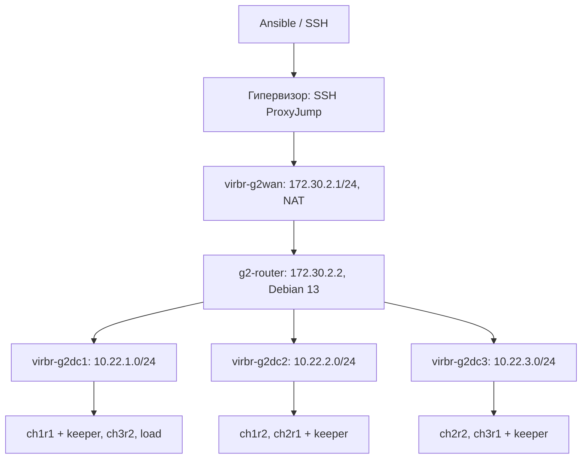

# Топология и адреса

На маршрутизаторе интерфейсы `wan0`, `dc1`, `dc2`, `dc3`; адрес шлюза каждого ДЦ — `.1`.
На узлах один интерфейс с именем ДЦ. Имена закреплены за MAC через cloud-init.
У мостов ДЦ нет IPv4-адресов гипервизора, поэтому он не может маршрутизировать между ними в обход ВМ.
Внутри ДЦ трафик идёт через L2-мост; между ДЦ — через router без NAT.
В интернет: SNAT на router → NAT libvirt на гипервизоре. Входящие публичные порты к ВМ не пробрасываются.
Гипервизор имеет три маршрута через `172.30.2.2` для SSH ProxyJump.
Домен всех ВМ: `<имя>.corp.internal`, временное разрешение через `/etc/hosts`.

| ВМ | Назначение | ДЦ | IP | RAM, МиБ | Диски данных |
|---|---|---|---|---:|---|
| g2-router | router | wan | 172.30.2.2 | 512 | — |
| g2-ch1r1 | clickhouse | dc1 | 10.22.1.11 | 1024 | 4 × 5 ГиБ |
| g2-ch1r2 | clickhouse | dc2 | 10.22.2.11 | 1024 | 4 × 5 ГиБ |
| g2-ch2r1 | clickhouse | dc2 | 10.22.2.12 | 1024 | 4 × 5 ГиБ |
| g2-ch2r2 | clickhouse | dc3 | 10.22.3.12 | 1024 | 4 × 5 ГиБ |
| g2-ch3r1 | clickhouse | dc3 | 10.22.3.13 | 1024 | 4 × 5 ГиБ |
| g2-ch3r2 | clickhouse | dc1 | 10.22.1.13 | 1024 | 4 × 5 ГиБ |
| g2-load | load | dc1 | 10.22.1.30 | 512 | — |

Шард 1: dc1 + dc2, шард 2: dc2 + dc3, шард 3: dc3 + dc1.
ClickHouse Keeper работает на `g2-ch1r1`, `g2-ch2r1`, `g2-ch3r1` — по одному
узлу в каждом ДЦ; клиентский порт 9181, Raft 9234, метрики 9365. Отдельных
ZooKeeper-ВМ в актуальном стенде нет: прежние `g2-zk1..3` были заглушками.
`raid_level` в inventory — предложение для ответственного за хранилище: 10 / 5 / 6 по шардам.
На каждом ClickHouse корневой диск `vda` (8 ГиБ), четыре пустых `vdb..vde` (по 5 ГиБ).
У дисков стабильные serial `g2-chXrY-data1..4` и `/dev/disk/by-id/virtio-*`.
RAID/LVM/XFS создаёт роль ответственного за хранилище, этот проект их не форматирует.
Сейчас данные ClickHouse лежат на корневом диске; после монтирования RAID
переопределите `clickhouse_data_root`.

Фиксированный IP-план следует согласовать с группами 1 и 3 до интеграции.
При смене подсетей обновите также маршруты и nftables в шаблонах: они намеренно отражают эту схему.
